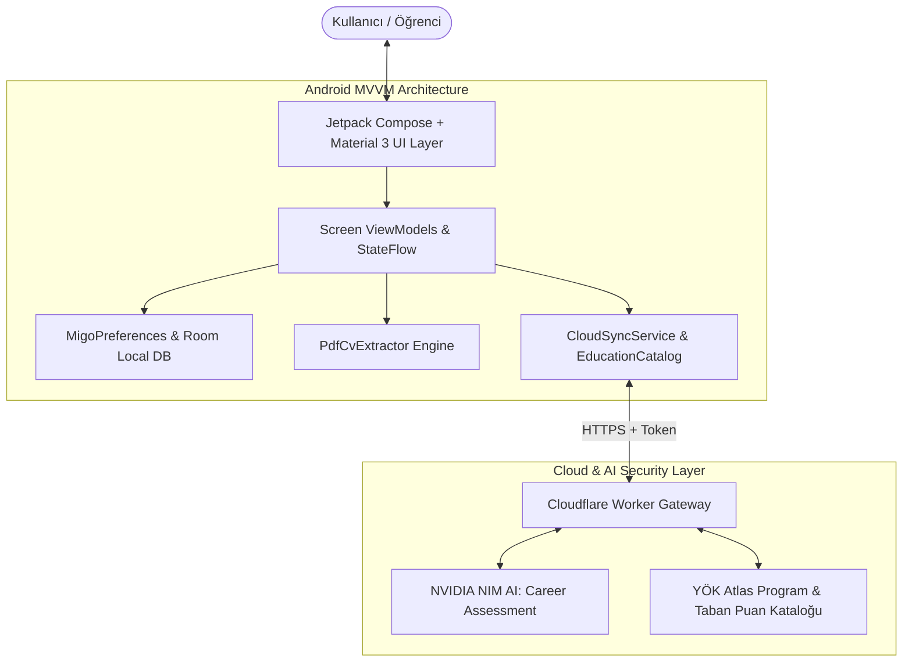

<div align="center">

# 📱 Mİ-GO — AI Destekli Kişisel Kariyer & Eğitim Pusulası

[-3DDC84?style=for-the-badge&logo=android&logoColor=white)](https://developer.android.com)
[](https://kotlinlang.org)
[](https://developer.android.com/jetpack/compose)
[](https://build.nvidia.com)
[](LICENSE)

<p align="center">
  <strong>"Hangi kariyer? Hangi üniversite? Hangi beceriler?"</strong><br>
  Öğrencilerin ve profesyonellerin yetkinliklerini analiz edip kişiselleştirilmiş kariyer rotası ve günlük gelişim planı sunan yeni nesil mobil rehber.
</p>

[Özellikler](#-temel-özellikler) • [Mimari Şeması](#%EF%B8%8F-sistem-mimarisi) • [Derleme & Kurulum](#-derleme--kurulum) • [Geliştirici](#-geli%C5%9Ftirici)

---

</div>

## 🎯 Problem & Vizyon

Üniversite ve kariyer seçimi aşamasındaki milyonlarca genç, binlerce farklı bölüm ve meslek arasında kaybolmaktadır. Geleneksel rehberlik testleri statik ve yetersiz kalırken; iş dünyasının ihtiyaç duyduğu gerçek beceriler hızla değişmektedir.

**Mİ-GO**, YÖK Atlas program verilerini ve modern yapay zekâ muhakeme modellerini birleştirerek kullanıcıya **yaşayan, dinamik bir kariyer pusulası** çizer.

---

## 🏗️ Sistem Mimarisi



---

## ✨ Temel Özellikler

| Modül | Yetenek | Açıklama |
| :--- | :--- | :--- |
| 🎯 **AI Keşif & Analiz** | Kişiselleştirilmiş Yol Haritası | İlgi alanları, hobiler ve hedeflere göre uyumlu meslek ve kariyer patikaları |
| 📄 **PDF CV Okuyucu** | Anlık Profilleme | Kullanıcının özgeçmişini okuyarak eksik yetkinlikleri ve tamamlayıcı eğitimleri listeler |
| 🎓 **YÖK Atlas Entegrasyonu** | Canlı Üniversite Verisi | Türkiye'deki tüm lisans/önlisans programları, kontenjanlar ve başarı sıralamaları |
| 🎨 **Material 3 Tasarım** | Dinamik Arayüz | Ergonomik tipografi, akıcı animasyonlar ve modern karanlık/aydınlık tema desteği |
| 🔒 **Sıfır İstemci Güvensizliği** | Cloud Gateway | API anahtarları asla Android istemcisinde saklanmaz; Cloudflare Worker üzerinde korunur |

---

## 🚀 Derleme & Kurulum

### Ön Koşullar
* **Android Studio:** Ladybug / Hedgehog veya daha yenisi
* **JDK:** Java 17 / 21 (JBR)
* **Minimum SDK:** Android 7.0 (API 24)
* **Target SDK:** Android 15 (API 35+)

### 1. Android Studio ile Açma
Depoyu klonlayıp Android Studio'da açın:
```bash
git clone https://github.com/mehmeteminakkaya/Migo.git
```

### 2. Terminalden Debug APK Üretme (Windows PowerShell)
```powershell
$env:JAVA_HOME = "C:\Program Files\Android\Android Studio\jbr"
.\gradlew.bat :app:assembleDebug
```
*Derlenen APK `%LOCALAPPDATA%\MigoAndroidBuild\app\outputs` veya `app/build/outputs/apk/debug/` altında üretilir.*

### 3. Test ve Kalite Kontrolleri
```powershell
# Birim testleri ve Lint kontrollerini çalıştırın:
.\gradlew.bat :app:testDebugUnitTest :app:lintDebug
```

---

## 🛠️ Teknoloji Yığını

* **Dil:** Kotlin 2.0+, Coroutines & StateFlow
* **Arayüz:** Jetpack Compose, Material 3, Navigation Compose
* **Veri:** DataStore Preferences, OkHttp3, Kotlinx Serialization
* **AI & Veri Kaynağı:** NVIDIA NIM Inference API, YÖK Atlas API Catalog
* **Backend:** Cloudflare Workers, Cloudflare D1 Serverless SQL

---

## 👨‍💻 Geliştirici & İletişim

**Mehmet Emin Akkaya**  
*İstinye Üniversitesi Bilgisayar Mühendisliği | Bilişim Kulübü Başkan Yardımcısı*

* 🌐 **Portfolyo:** [mehmeteminakkaya.com](https://mehmeteminakkaya.com)
* 💼 **LinkedIn:** [linkedin.com/in/mehmeteminakkaya](https://www.linkedin.com/in/mehmeteminakkaya/)
* 🐙 **GitHub:** [@mehmeteminakkaya](https://github.com/mehmeteminakkaya)
* 📬 **E-Posta:** [mehmeteminakkaya12@gmail.com](mailto:mehmeteminakkaya12@gmail.com)

---

<div align="center">
  <sub>Telif Hakkı © 2026 Mİ-GO Team & Mehmet Emin Akkaya. Tüm hakları saklıdır.</sub>
</div>
